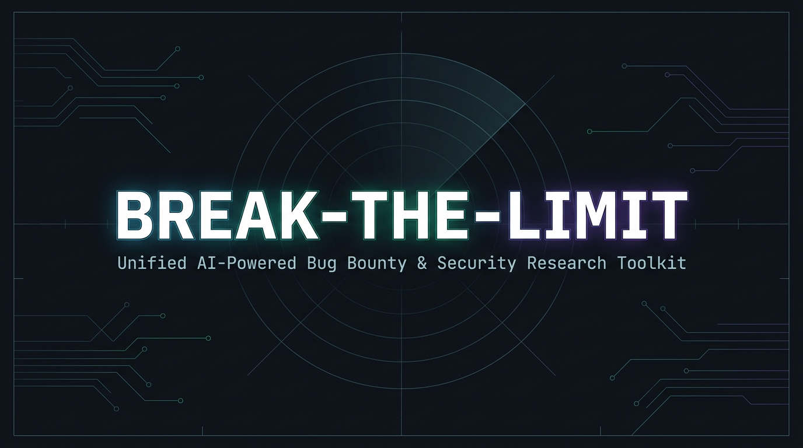

<p align="center">
  
</p>

<h1 align="center">Break-The-Limit</h1>

<p align="center">
  Terminal-native AI offensive security &amp; bug bounty toolkit — powered by <code>breach</code>.
</p>

<p align="center">
  Authorized security testing only — see <a href="#disclaimer">Disclaimer</a>.
</p>

<p align="center">
  <a href="#license"></a>
  
  <a href="https://github.com/SltnBM/Break-The-Limit/actions/workflows/tests.yml"></a>
</p>

---

## Overview

Break-The-Limit (`breach`) adalah toolkit offensive security dan bug bounty di terminal dengan injeksi playbook taktis (`breach skills`), router multi-provider (termasuk `9Router`, endpoint gratisan/lokal, dan Google OAuth), serta proteksi *Untrusted Output Delimiter* terhadap *indirect prompt injection* dari target.

| Component | Fungsi | Path |
|---|---|---|
| `breach` CLI | Dispatcher utama untuk setup, chat interaktif, recon, hunt, dan report | [`bughunter/engine.py`](bughunter/engine.py) |
| Native Skill Engine | Loader yang menginjeksi 25 playbook taktis langsung ke sesi AI | [`bughunter/tools/skill_loader.py`](bughunter/tools/skill_loader.py) |
| Interactive Agentic Shell | Shell `breach chat` dengan eksekusi HTTP, pencarian CVE, dan shell lokal | [`bughunter/tools/chat_agent.py`](bughunter/tools/chat_agent.py) |
| Multi-Provider Brain | Klien LLM untuk OAuth, `9Router`, endpoint kustom/gratis, lokal, dan cloud | [`bughunter/brain.py`](bughunter/brain.py) |
| 25 Tactical Skills | Playbook eksploitasi Web, API, Logic, 0-Day Killchain, Cloud, Mobile, dan Web3 | [`skills/`](skills/) |
| 42 Slash Commands | Alur kerja terstruktur untuk harness eksternal | [`commands/`](commands/) |
| MCP Bridges | Server MCP lokal serta adapter Burp Suite, Caido, dan HackerOne | [`bughunter/mcp/`](bughunter/mcp/) |

---

## Quick Start

Gunakan virtual environment atau installer standalone agar `breach` langsung aktif di sistem.

```bash
git clone https://github.com/SltnBM/Break-The-Limit.git
cd Break-The-Limit
python3 -m venv .venv
source .venv/bin/activate
pip install -e ".[test]"

# Alternatif global tanpa virtualenv:
# ./install.sh --agent standalone

# Konfigurasi provider AI (9Router / Custom / Google OAuth / Ollama / Groq)
breach setup
breach chat
```

---

## Usage

### Core CLI Commands

Gunakan perintah berikut untuk mengatur provider, memuat skill, dan menjalankan pengujian.

| Task | Command |
|---|---|
| Konfigurasi provider AI (termasuk `9Router` / Custom URL) | `breach setup` |
| Setup cepat `9Router` lokal | `breach setup --provider 9router` |
| Lihat daftar model pada provider aktif | `breach models` |
| Lihat katalog 25 tactical skills | `breach skills` |
| Rekomendasikan skill berdasarkan sinyal target | `breach skills recommend graphql` |
| Mulai sesi hunting & diskusi cybersec interaktif | `breach chat` |
| Mulai chat dengan injeksi playbook spesifik | `breach chat --skill js-deep-miner,zero-day-killchain` |
| Jalankan pipeline recon & hunt otomatis | `breach hunt example.com` |

### In-Chat Slash Commands (`breach chat`)

Di dalam `breach chat`, AI berjalan dalam mode taktis bebas (tidak mengunci ke tahapan kaku) dan dapat dikontrol langsung dengan perintah berikut.

| In-Chat Command | Fungsi |
|---|---|
| `/skill <name>` | Muat playbook taktis (misal `/skill zero-day-killchain`) ke sesi aktif |
| `/skill clear` | Lepas seluruh skill dari konteks sesi |
| `/skills` | Tampilkan skill yang sedang aktif dan daftar 25 skill yang tersedia |
| `/target <domain>` | Muat data `recon/<target>` dan `findings/<target>` ke sesi chat |
| `/phase <0-5\|off>` | Kunci fokus ke Phase `0`–`5` tertentu, atau `off` untuk mode bebas |
| `/auto` | Aktifkan atau matikan auto-approve eksekusi tool (`http_fetch`, `run_command`) |
| `/clear` | Bersihkan riwayat percakapan sesi saat ini |

---

## Supported AI Providers

Konfigurasi melalui `breach setup`; daftar model default lengkap tersedia di [Supported AI Models](docs/supported-models.md).

### Custom, Community & Free Routers

| Provider | Auth | Catatan |
|---|---|---|
| `9router` | Custom URL | Preset `http://localhost:20128/v1`, auto-fetch daftar model |
| `custom` | Custom URL | Mendukung provider gratis/komunitas, `vLLM`, `LM Studio`, atau endpoint OpenAI-compatible |

### Subscription / OAuth & Local

| Provider | Auth | Catatan |
|---|---|---|
| `antigravity` (`agy`) | OAuth | Gemini AI Pro & Claude via Google OAuth tanpa API key |
| `gemini-oauth` | OAuth | Kredensial Google OAuth CLI (`~/.bughunter/google_oauth.json`) |
| `ollama` | Local | Gratis dan offline melalui daemon lokal `OLLAMA_HOST` |

### Cloud API & Multi-Model Gateways

| Provider | Auth | Catatan |
|---|---|---|
| `groq` | API key | `GROQ_API_KEY`, free tier berkecepatan tinggi |
| `cerebras` | API key | `CEREBRAS_API_KEY`, inferensi latensi rendah |
| `deepseek` | API key | `DEEPSEEK_API_KEY`, model DeepSeek V4 |
| `gemini` | API key | `GEMINI_API_KEY`, Google Gemini API |
| `claude` | API key | `ANTHROPIC_API_KEY`, Anthropic Claude API |
| `openai` | API key | `OPENAI_API_KEY`, OpenAI API |
| `grok` | API key | `XAI_API_KEY`, xAI Grok API |
| `kimi` | API key | `MOONSHOT_API_KEY`, Moonshot AI API |
| `mistral` | API key | `MISTRAL_API_KEY`, Mistral AI API |
| `together` | API key | `TOGETHER_API_KEY`, model open-weight cloud |
| `perplexity` | API key | `PERPLEXITY_API_KEY`, pencarian web terintegrasi |
| `openrouter` | API key | `OPENROUTER_API_KEY`, multi-model gateway |
| `orcarouter` | API key | `ORCAROUTER_API_KEY`, multi-model gateway |
| `fluxion` | API key | `FLUXION_API_KEY`, multi-model gateway |
| `requesty` | API key | `REQUESTY_API_KEY`, multi-model gateway |
| `litellm` | API key | `LITELLM_API_KEY`, gateway 100+ provider |

---

## Tactical Skills & Slash Commands

### Tactical Skills (25)

Seluruh 25 skill di [`skills/`](skills/) dapat dilihat dengan `breach skills` dan diinjeksi langsung ke `breach chat` melalui `--skill <name>` atau `/skill <name>`.

| Domain | Jumlah | Playbook (`skills/`) |
|---|---|---|
| Core & Chaining | 3 | `btl-methodology`, `btl-master-hunt`, `exploit-chaining` |
| Web, API & 0-Day | 5 | `web-exploit-matrix`, `business-logic-assault`, `zero-day-killchain`, `graphql-offensive`, `payload-arsenal` |
| Code & JS Analysis | 3 | `js-deep-miner`, `client-js-reverse`, `taint-trace-audit` |
| Recon, Auth & PII | 3 | `surface-recon`, `pii-exposure-hunter`, `cred-spray-ops` |
| Cloud, CI/CD & Mobile | 3 | `cloud-post-exploit`, `pipeline-exploitation`, `mobile-runtime-audit` |
| AI, Agentic & MCP | 3 | `ai-prompt-redteam`, `agentic-system-audit`, `mcp-security-audit` |
| Web3 & Token Audit | 2 | `defi-contract-audit`, `token-rugpull-audit` |
| Triage & Reporting | 3 | `impact-gate`, `bounty-reporting`, `vrt-triage-reporting` |

### Slash Commands (42)

Dua belas command utama ditampilkan di bawah ini; daftar lengkap 42 command tersedia pada bagian lipat.

| Kategori | Command | Fungsi |
|---|---|---|
| Recon | `/recon` | Jalankan pipeline recon lengkap |
| Recon | `/scope` | Verifikasi aset terhadap scope program |
| Recon | `/surface` | Urutkan prioritas attack surface target |
| Hunt | `/hunt` | Jalankan pengujian kerentanan aktif |
| Hunt | `/autopilot` | Jalankan loop hunt otomatis |
| Hunt | `/chain` | Rangkai beberapa temuan menjadi eskalasi |
| Validate & Report | `/validate` | Jalankan 7-Question Gate pada temuan |
| Validate & Report | `/triage` | Evaluasi cepat kelayakan temuan |
| Validate & Report | `/report` | Buat draf laporan siap kirim |
| Utilities | `/pickup` | Lanjutkan sesi hunt sebelumnya |
| Web3 & OSINT | `/web3-audit` | Audit smart contract Solidity/Rust |
| Web3 & OSINT | `/token-scan` | Pindai risiko rug pull token |

<details>
<summary>Daftar lengkap 42 Slash Commands (<code>commands/</code>)</summary>

| Kategori | Command | Fungsi |
|---|---|---|
| Recon | `/recon` | Jalankan pipeline recon lengkap |
| Recon | `/scope` | Verifikasi aset terhadap scope program |
| Recon | `/scope-aggregate` | Kumpulkan scope dari berbagai platform |
| Recon | `/surface` | Urutkan prioritas attack surface target |
| Recon | `/cloud-recon` | Cari bucket publik dan origin IP |
| Recon | `/param-discover` | Temukan parameter HTTP tersembunyi |
| Recon | `/secrets-hunt` | Pindai kebocoran kredensial di kode |
| Recon | `/takeover` | Periksa kandidat subdomain takeover |
| Recon | `/portscan` | Pindai port layanan pada target |
| Recon | `/intel` | Ambil data CVE dan laporan publik |
| Hunt | `/hunt` | Jalankan pengujian kerentanan aktif |
| Hunt | `/autopilot` | Jalankan loop hunt otomatis |
| Hunt | `/chain` | Rangkai beberapa temuan menjadi eskalasi |
| Hunt | `/bypass-403` | Uji teknik bypass HTTP 403/401 |
| Hunt | `/cors` | Pindai kesalahan konfigurasi CORS |
| Hunt | `/crlf` | Uji CRLF dan host header injection |
| Hunt | `/domxss` | Konfirmasi DOM XSS di browser |
| Hunt | `/jwt-scan` | Analisis dan uji token JWT offline |
| Hunt | `/nosqli` | Pindai celah injeksi NoSQL |
| Hunt | `/oob` | Korelasi callback out-of-band interactsh |
| Hunt | `/scan-cves` | Sapuan template Nuclei untuk CVE |
| Hunt | `/sast` | Jalankan aturan Semgrep pada source |
| Hunt | `/llm-app-audit` | Audit black-box aplikasi agen AI |
| Hunt | `/llm-redteam` | Uji prompt injection dan jailbreak |
| Hunt | `/spray` | Password spray dengan pengaman lockout |
| Validate & Report | `/validate` | Jalankan 7-Question Gate pada temuan |
| Validate & Report | `/triage` | Evaluasi cepat kelayakan temuan |
| Validate & Report | `/verify` | Verifikasi ulang bundle PoC secara independen |
| Validate & Report | `/report` | Buat draf laporan siap kirim |
| Validate & Report | `/poc` | Susun template bukti reproduksi PoC |
| Validate & Report | `/screenshot` | Ambil tangkapan layar daftar host aktif |
| Validate & Report | `/remember` | Simpan temuan ke memori hunt |
| Utilities | `/arsenal` | Daftar tool eksternal yang terpasang |
| Utilities | `/dashboard` | Buka dashboard lokal hasil hunt |
| Utilities | `/memory-gc` | Rotasi dan bersihkan log memori |
| Utilities | `/oracle` | Urutkan prioritas lead berbasis histori |
| Utilities | `/pickup` | Lanjutkan sesi hunt sebelumnya |
| Web3 & OSINT | `/web3-audit` | Audit smart contract Solidity/Rust |
| Web3 & OSINT | `/token-scan` | Pindai risiko rug pull token |
| Web3 & OSINT | `/wordlist-gen` | Buat wordlist khusus dari situs target |
| Web3 & OSINT | `/osint-employees` | Kumpulkan OSINT nama dan email karyawan |
| Web3 & OSINT | `/breach-check` | Cek wordlist terhadap API HIBP |

</details>

---

## MCP Integrations

Server dan klien MCP berikut menghubungkan `breach` ke proxy HTTP serta API platform bug bounty.

| Integration | Fungsi | Path |
|---|---|---|
| Break-The-Limit MCP | Server MCP lokal (`breach mcp serve`) dengan redaksi otomatis | [`bughunter/mcp/bughunter-mcp/`](bughunter/mcp/bughunter-mcp/) |
| Burp Suite MCP Client | Klien bridge untuk proxy Burp Suite | [`bughunter/mcp/burp-mcp-client/`](bughunter/mcp/burp-mcp-client/) |
| Caido MCP Client | Klien bridge untuk proxy Caido | [`bughunter/mcp/caido-mcp-client/`](bughunter/mcp/caido-mcp-client/) |
| HackerOne MCP | Helper API publik HackerOne dan Hacktivity | [`bughunter/mcp/hackerone-mcp/`](bughunter/mcp/hackerone-mcp/) |

---

## Repository Structure

```text
Break-The-Limit/
├── assets/          # Project banner (assets/banner.png)
├── bughunter/       # Core breach CLI engine, multi-provider brain, skill loader, chat agent, tools, MCP
├── skills/          # 25 Break-The-Limit tactical security playbooks
├── commands/        # 42 slash command definitions (+ README.md)
├── hooks/           # Harness lifecycle hooks
├── rules/           # Hunting & reporting rules
├── scripts/         # Utility scripts
├── docs/            # Guides & verified model catalog
└── tests/           # Automated test suite (pytest)
```

---

## Disclaimer

Break-The-Limit dikembangkan dan disediakan hanya untuk tujuan edukasi, bug bounty resmi, dan riset keamanan yang sah.

- **No Liability:** Penulis dan kontributor tidak bertanggung jawab atas penyalahgunaan, kerusakan sistem, kehilangan data, atau aktivitas ilegal yang dilakukan menggunakan perangkat lunak ini.
- **Authorized Use Only:** Perangkat ini hanya boleh digunakan terhadap sistem, aplikasi, dan jaringan yang memiliki izin resmi atau termasuk dalam cakupan program bug bounty yang sah.
- **User Responsibility:** Pengguna bertanggung jawab penuh memastikan seluruh aktivitas mematuhi hukum dan peraturan yang berlaku.

---

## License

Licensed under the MIT License — see [LICENSE](LICENSE).
