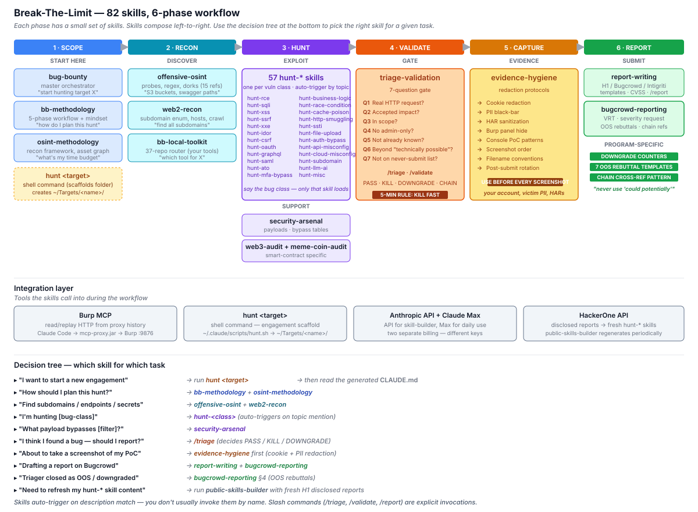

<p align="center">
  
</p>

<h1 align="center">Break-The-Limit</h1>

<p align="center">
  <b>Unified AI-powered bug bounty &amp; security research toolkit — recon to report, in your terminal.</b>
</p>

<p align="center">
  <a href="#overview">Overview</a> ·
  <a href="#quick-start">Quick Start</a> ·
  <a href="#usage-guide">Usage Guide</a> ·
  <a href="#supported-ai-providers">AI Providers</a> ·
  <a href="#skill--command-coverage">Skills &amp; Commands</a> ·
  <a href="#mcp-integrations">MCP</a> ·
  <a href="#disclaimer">Disclaimer</a> ·
  <a href="#license">License</a>
</p>

<p align="center">
  <a href="#license"></a>
  
  
  
  <a href="https://github.com/SltnBM/Break-The-Limit/actions/workflows/tests.yml"></a>
</p>

---

## Overview

**Break-The-Limit** unifies terminal-native security automation, an interactive AI hunting agent, 99 domain-specific vulnerability playbooks, and MCP proxy/platform integrations into a single cohesive framework.

| Component | Role | Entry Point / Path |
|---|---|---|
| **`bughunter` CLI** | Interactive AI hunting agent (`bughunter chat`), Phase 0–5 workflow, `--phase` / `--target` resume, OAuth & custom providers | [`bughunter/`](bughunter/) |
| **`cbh` CLI & Engine** | Terminal-native recon, classification, triage, and report runner backed by a persistent ledger | [`cbh/`](cbh/), [`engine/`](engine/) |
| **99 Security Skills** | Modular playbooks across Web2, API, GraphQL, Auth/OAuth/SAML, Cloud IAM, K8s, CI/CD, Mobile, LLM/MCP, Web3 & OSINT | [`skills/`](skills/) |
| **43 Slash Commands** | Structured workflows (`/recon`, `/hunt`, `/validate`, `/report`, `/chain`, `/scope`, `/triage`, `/autopilot`, `/surface`, `/web3-audit`) | [`commands/`](commands/) |
| **MCP Integrations** | Policy-enforced adapters for HackerOne, Burp Suite, Caido, and local research tools | [`mcp/`](mcp/), [`bughunter/mcp/`](bughunter/mcp/) |
| **Automated Test Suite** | Cross-platform unit, schema, scope, and tool-path verification (`1,216 passed`) | [`tests/`](tests/) |

---

## Architecture

<p align="center">
  
</p>

1. **Orchestration Layer (`bughunter` & `cbh`):** Handles provider routing, scope enforcement, persistent per-target session state, and Phase 0–5 execution.
2. **Knowledge & Playbook Layer (`skills/`, `commands/`, `rules/`):** Injects targeted bug-class methodologies, bypass tables, and validation gates into your AI harness or terminal agent.
3. **Tooling & Integration Layer (`bughunter/tools/`, `scripts/`, `mcp/`):** Connects external scanners, HTTP proxies (Burp/Caido), and HackerOne intelligence with built-in rate limiting and redaction.

---

## Quick Start

### 1. Clone & Install Python Package

```bash
git clone https://github.com/SltnBM/Break-The-Limit.git
cd Break-The-Limit
pip install -e ".[test]"
```

### 2. Optional: Install Harness Skills (Claude Code / OpenCode / Pi / Codex)

```bash
chmod +x install.sh
./install.sh                  # default install
./install.sh --agent opencode # OpenCode (~/.config/opencode/)
./install.sh --agent codex    # Codex (~/.codex/)
./install.sh --agent all      # all supported harnesses
```

### 3. Configure AI Provider

```bash
bughunter setup
bughunter models
```

---

## Usage Guide

| Task | Command | Notes |
|---|---|---|
| **Configure Provider** | `bughunter setup` | Interactive setup for Google OAuth (`agy`), Custom Provider, or API keys |
| **List Available Models** | `bughunter models` | Displays active provider and selectable models |
| **Start Interactive Hunt** | `bughunter chat` | Launches the AI assistant with network/tool execution & Phase 0–5 workflow |
| **Resume Target by Phase** | `bughunter chat --target example.com --phase 3` | Jumps directly to Phase `0`–`5` using saved per-target session state |
| **Run CLI Hunt Pipeline** | `bughunter hunt example.com` | Automated recon, surface ranking, and lead-board ingestion |
| **Run `cbh` Runner** | `cbh --help` | Recon classification, triage, and report generation |
| **Run Test Suite** | `pytest -q` | Executes the full automated verification suite |

### Structured Hunting Workflow (Phase 0 – Phase 5)

| Phase | Stage | Objective |
|---|---|---|
| **Phase 0** | **Scope** | Verify in-scope domains, wildcards, and out-of-scope exclusions before touching any asset |
| **Phase 1** | **Reconnaissance** | Subdomain enumeration, live host probing, JS/endpoint extraction, and tech fingerprinting |
| **Phase 2** | **Surface Ranking** | Prioritize high-yield endpoints, auth flows, APIs, and shadow/legacy surfaces |
| **Phase 3** | **Targeted Hunting** | Test specific vulnerability classes (IDOR, Auth/OAuth, SSRF, SQLi, XSS, Business Logic, etc.) |
| **Phase 4** | **Validation** | Pass the **7-Question Gate** & 4 pre-submission checks to eliminate false positives |
| **Phase 5** | **PoC & Reporting** | Bundle reproducible evidence, compute CVSS 3.1, and generate submission-ready reports |

---

## Supported AI Providers

| Category | Provider | Authentication / Endpoint | Default / Notes |
|---|---|---|---|
| **Google Subscription** | **Antigravity / Gemini OAuth (`agy`)** | Google OAuth (no API key required) | `gemini-3.8-flash-medium`, `gemini-4-argon-high`, Claude via `agy` |
| **Custom Endpoint** | **Custom Provider** | Custom Base URL + optional API key | Compatible with `9router`, local vLLM, LM Studio, or any OpenAI-compatible server |
| **Local (Zero Cost)** | **Ollama** | Local daemon (`ollama serve`) | Runs local models (`qwen2.5`, `deepseek-r1`, etc.) offline |
| **Cloud Free / Fast** | **Groq**, **Cerebras** | `GROQ_API_KEY`, `CEREBRAS_API_KEY` | Low-latency cloud inference (`openai/gpt-oss-20b`, etc.) |
| **Direct Model APIs** | **Gemini**, **Claude**, **OpenAI**, **DeepSeek**, **Grok**, **Mistral**, **Kimi** | Provider API Key | `gemini-3.8-flash-high`, `claude-sonnet`, `gpt-4o`, `deepseek-v4-flash` |
| **Multi-Model Gateways** | **OpenRouter**, **OrcaRouter**, **Together**, **Perplexity**, **Requesty** | Gateway API Key | Unified routing across multiple frontier and open-weight models |

---

## Skill & Command Coverage

| Domain | Included Skills (`skills/`) |
|---|---|
| **Core Methodology & Triage** | `bb-methodology`, `bug-bounty`, `triage-validation`, `report-writing`, `bugcrowd-reporting`, `evidence-hygiene`, `redteam-mindset`, `redteam-report-template` |
| **Web & API Exploitation** | `hunt-idor`, `hunt-ssrf`, `hunt-sqli`, `hunt-nosqli`, `hunt-xss`, `hunt-csrf`, `hunt-cors`, `hunt-rce`, `hunt-lfi`, `hunt-xxe`, `hunt-ssti`, `hunt-deserialization`, `hunt-http-smuggling`, `hunt-cache-poison`, `hunt-race-condition`, `hunt-business-logic`, `hunt-graphql`, `hunt-fintech-graphql`, `hunt-grpc`, `hunt-websocket`, `hunt-shadow-api`, `hunt-spa-api` |
| **Auth, Identity & SSO** | `hunt-ato`, `hunt-auth-bypass`, `hunt-oauth`, `hunt-saml`, `hunt-jwt-crypto`, `hunt-mfa-bypass`, `hunt-session`, `hunt-forgot-password`, `m365-entra-attack`, `okta-attack` |
| **Cloud, Infra & CI/CD** | `hunt-cloud-misconfig`, `cloud-iam-deep`, `hunt-k8s`, `hunt-cicd`, `supply-chain-attack-recon`, `enterprise-vpn-attack`, `vmware-vcenter-attack`, `hunt-sharepoint`, `hunt-aspnet`, `hunt-laravel`, `hunt-springboot`, `hunt-nextjs`, `hunt-nodejs` |
| **AI / LLM & Web3** | `hunt-llm-ai`, `hunt-rag-vector`, `web3-audit`, `meme-coin-audit` |
| **Mobile & OSINT** | `apk-redteam-pipeline`, `ios-redteam-pipeline`, `offensive-osint`, `osint-methodology`, `web2-recon`, `recon-scope-triage`, `jsmax` |

<details>
<summary><b>View all 43 Slash Commands (<code>commands/</code>)</b></summary>

| Command | Purpose | Command | Purpose |
|---|---|---|---|
| `/recon` | Full recon pipeline | `/hunt` | Start targeted hunting |
| `/validate` | Run 7-Question Gate | `/report` | Generate submission-ready report |
| `/chain` | Build A→B→C exploit chains | `/scope` | Verify asset against scope |
| `/scope-aggregate` | Aggregate program scope | `/triage` | Quick finding triage |
| `/surface` | Rank attack surface | `/pickup` | Resume previous hunt |
| `/autopilot` | Autonomous hunt loop | `/remember` | Save finding to hunt memory |
| `/intel` | Fetch CVE & disclosure intel | `/memory-gc` | Rotate/clean hunt memory |
| `/secrets-hunt` | Scan JS/bundles for secrets | `/takeover` | Check subdomain takeover |
| `/cloud-recon` | S3/Azure/GCP & origin recon | `/param-discover` | Hidden HTTP param discovery |
| `/bypass-403` | 403/401 bypass checks | `/scan-cves` | Focused Nuclei CVE sweep |
| `/graphql-audit` | Full GraphQL security audit | `/web3-audit` | Smart contract audit |
| `/token-scan` | Token/meme coin rug-pull scan | `/arsenal` | List installed external tools |
| `/wordlist-gen` | Target-specific wordlists | `/osint-employees` | Employee OSINT (opt-in) |
| `/breach-check` | HIBP k-anonymity check | `/spray` | Guarded password spray |

</details>

---

## MCP Integrations

| Integration | Purpose | Path |
|---|---|---|
| **Break-The-Limit MCP** | Policy-enforced MCP server with redaction and tool gating | [`bughunter/mcp/bughunter-mcp/`](bughunter/mcp/bughunter-mcp/) |
| **HackerOne MCP** | Query Hacktivity, program policies, and scope metadata | [`mcp/hackerone/`](mcp/hackerone/), [`bughunter/mcp/hackerone-mcp/`](bughunter/mcp/hackerone-mcp/) |
| **Burp Suite & Caido MCP** | Proxy request/response inspection and replay bridges | [`bughunter/mcp/burp-mcp-client/`](bughunter/mcp/burp-mcp-client/), [`bughunter/mcp/caido-mcp-client/`](bughunter/mcp/caido-mcp-client/) |

---

## Repository Structure

```text
Break-The-Limit/
├── bughunter/       # Core bughunter CLI, chat agent, OAuth/providers, tools, memory, MCP
├── cbh/             # cbh CLI package for recon/classify/triage/report
├── engine/          # Ledger & state engine
├── skills/          # 99 domain-specific security & hunting skills
├── commands/        # 43 slash command workflows
├── hooks/           # Harness hooks
├── rules/           # Always-active hunting & reporting rules
├── mcp/             # MCP server adapters
├── scripts/         # Utility & bootstrap scripts
├── docs/            # Architecture, CLI, verification & methodology documentation
└── tests/           # Automated test suite (pytest)
```

---

## Running Tests

```bash
pytest -q
```

---

## Disclaimer

**Break-The-Limit** is developed and provided **strictly for educational purposes, authorized bug bounty hunting, and legitimate security research**.

- **No Liability:** The authors, maintainers, and contributors of **Break-The-Limit** are **not responsible or liable** for any misuse, damage, data loss, or illegal activities conducted using this toolkit or any of its components.
- **Authorized Use Only:** You may only use this project against systems, applications, and networks for which you have **explicit, written authorization** or that fall strictly within an **approved bug bounty program scope**.
- **User Responsibility:** End users are solely responsible for ensuring that their actions comply with all applicable local, national, and international laws and regulations.

---

## License

Licensed under the **MIT License** — see [LICENSE](LICENSE).
